# Chalo Rider: App Redesign (HCI Case Study)

A user-centred redesign of **Chalo Rider**, a ride-booking app used in Mirpur, AJK, for rickshaws, cars and vans. The redesign fixes eight usability problems found in the current app, led by confusing ride selection, drivers who are hard to identify, and dead-end errors.

**[▶ Open the interactive Figma prototype](https://www.figma.com/proto/kdbBNVHtjMNYoRkersrr9P/ChaloRider-Redesign-%E2%80%93-HCI-Assignment-2?node-id=17-5&p=f&t=G3Nv7Ecf3pftYPNb-1&scaling=min-zoom&content-scaling=fixed&page-id=12%3A2&starting-point-node-id=12%3A47)** · [Full report (PDF)](report/Chalo-Rider-Redesign-Report.pdf)

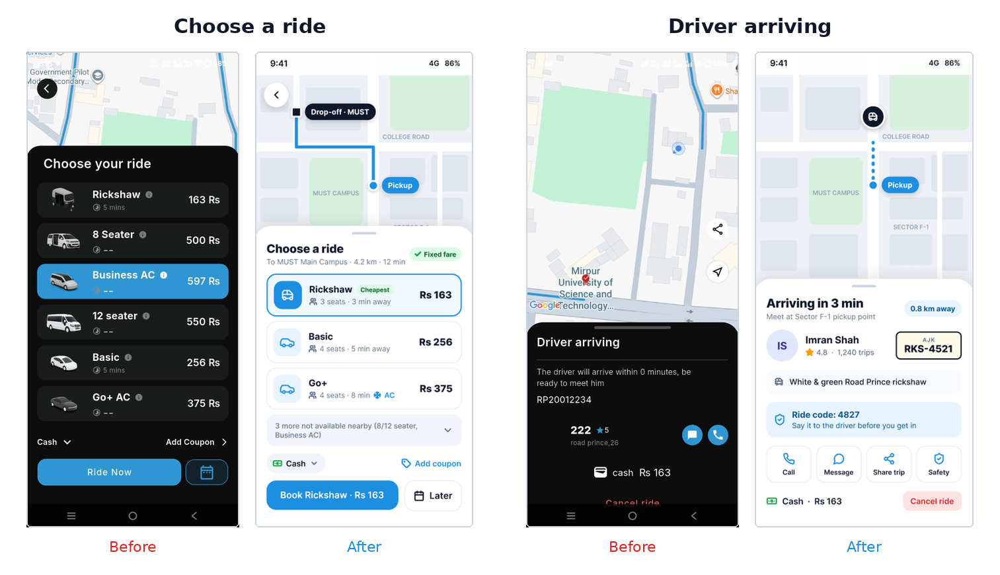

> **Disclaimer:** This is an unofficial concept redesign made for a university Human-Computer Interaction course. It is not affiliated with or endorsed by Chalo.

---

## The problem

A heuristic walkthrough of a real booking, plus short interviews with riders, found eight usability problems:

| # | Pain point | Evidence in the current app | HCI principle affected |
| --- | --- | --- | --- |
| 1 | Confusing ride selection | Six options in random price order; the most expensive (Business AC, Rs 597) is preselected; most wait times show “--” | Error prevention |
| 2 | Driver hard to identify | Driver shown as “222” with no photo or number plate; “will arrive within 0 minutes” | Error prevention (safety) |
| 3 | Unreadable addresses | Pickup shown as plus code “5P2W+894”; recent searches listed under “Favorite Places” | Match with the real world; consistency |
| 4 | Dead-end error | “No drivers found” offers only Try Again, partly hidden by the nav bar | Help users recover from errors |
| 5 | Unclear waiting state | “0:59” timer with no explanation; no ride summary while searching | Visibility of system status |
| 6 | Hidden and unlabelled controls | Main features in a hamburger menu; unlabelled calendar, “+” and share icons | Recognition over recall; affordance |
| 7 | Poor accessibility | Low-contrast grey text; pickup and drop-off told apart by colour only; English only | Accessibility |
| 8 | Cluttered cancel dialog | Eight reasons, including both “other” and “Other” | Consistency |

## Who it's for

Three personas guided the design. The primary persona is **Ayesha Khan**, a budget-conscious MUST student who books 4–5 short trips a week and *“just wants the cheapest ride to campus, not to hunt for it in a list.”*

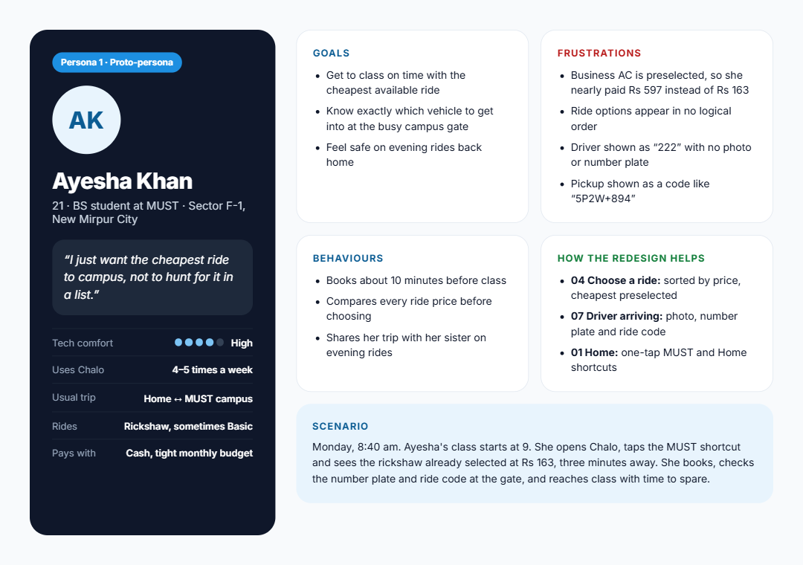

The other two personas, [Usman Raza](personas/persona-2-usman-raza.png) (a working professional commuting at rush hour) and [Nasreen Akhtar](personas/persona-3-nasreen-akhtar.png) (an older rider with low tech confidence), cover reliability and accessibility needs.

## Design approach

Three layout concepts were explored. The final design combines the best of each:

| Concept | Core idea | Decision |
| --- | --- | --- |
| A. Map + bottom sheet | Map always visible; each step slides up in a sheet | **Chosen as the base** |
| B. Shortcut-first | Saved places and last trip, booking in two taps | **Shortcuts adopted** into Home |
| C. Price-first comparison | All vehicles in a comparison list | **Sorted list adopted**; unavailable rides grouped away |

**Key features**

1. **Smart default:** the cheapest *available* ride is preselected, never the most expensive.
2. **Grouped unavailable rides:** vehicles with no nearby driver collapse into one line.
3. **Ride code verification:** a 4-digit code, the driver's name and a large number plate help riders board the right vehicle.
4. **Smart alternative while waiting:** a one-tap switch to a faster vehicle type.
5. **No dead ends:** when no driver is found, the trip is kept and the next-best ride is offered.
6. **Fixed-fare badge:** the price shown is the price paid.

## Before and after

| Screen | Before | After |
| --- | --- | --- |
| Home | 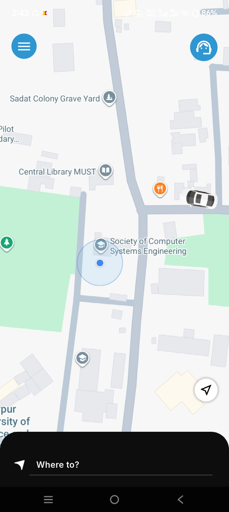 | 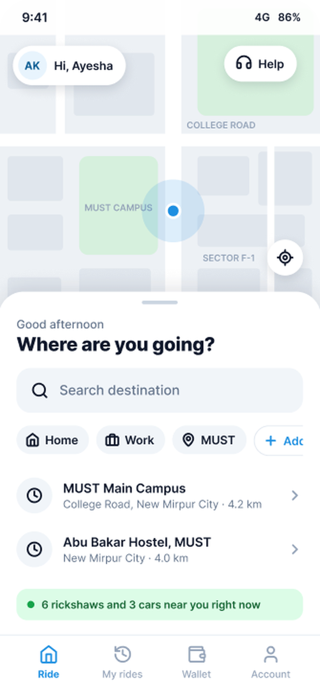 |
| Plan your ride | 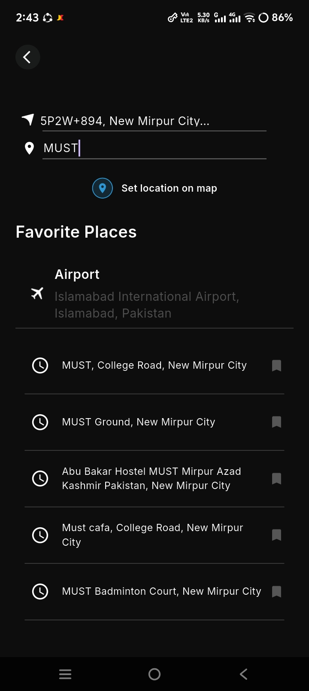 | 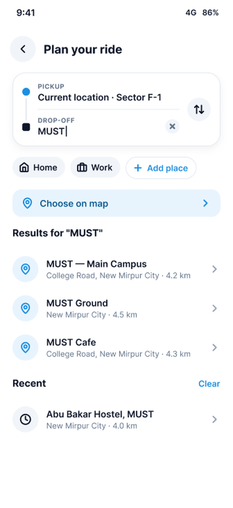 |
| Confirm route | 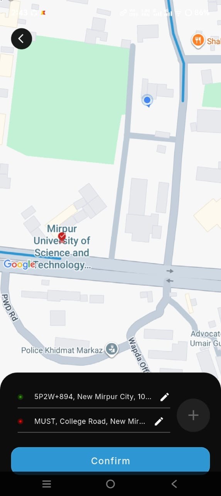 | 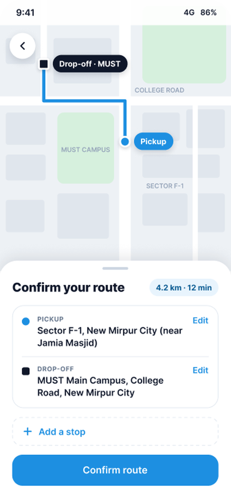 |
| Choose a ride | 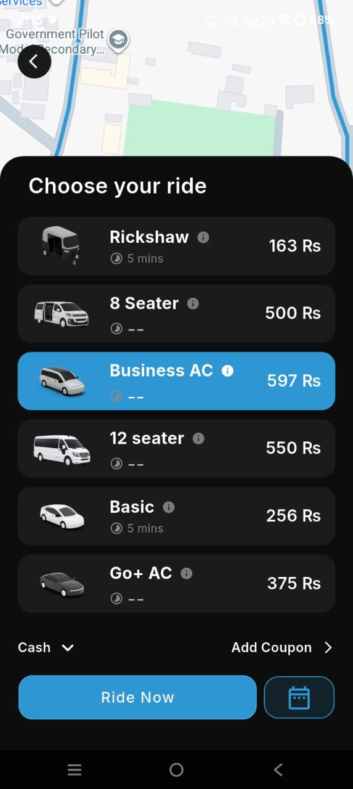 | 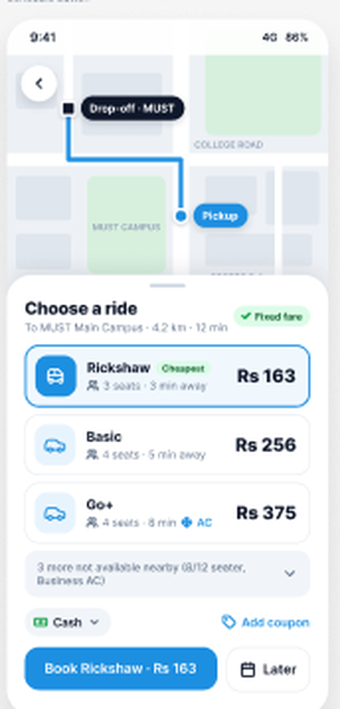 |
| Finding a driver | 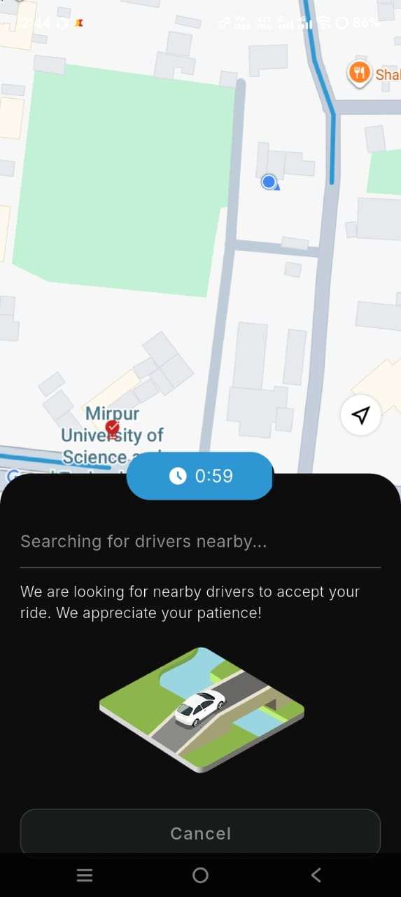 | 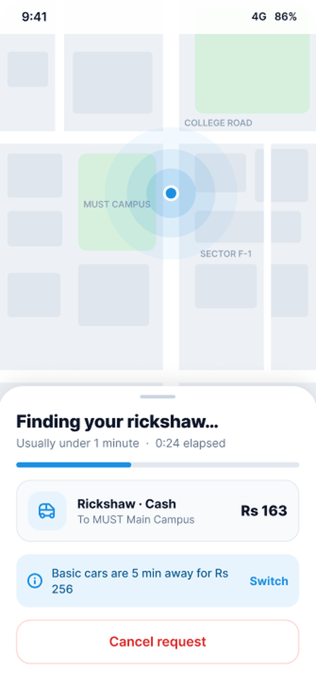 |
| No drivers nearby | 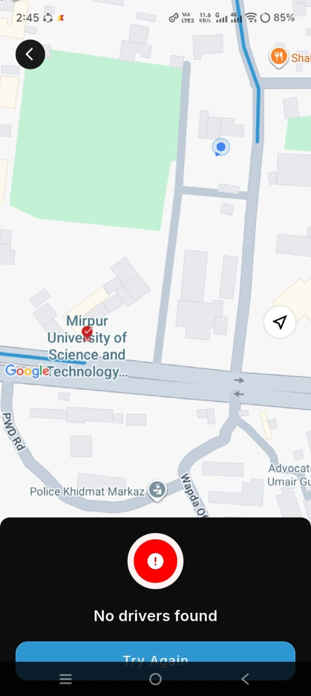 | 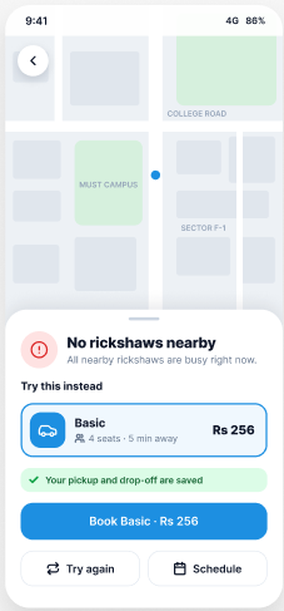 |
| Driver arriving | 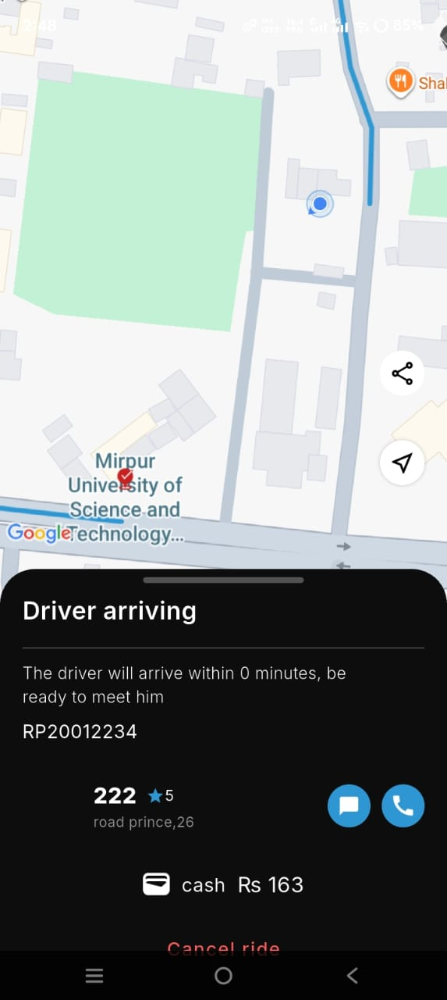 | 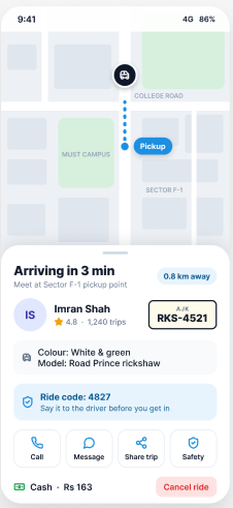 |
| Cancel ride | 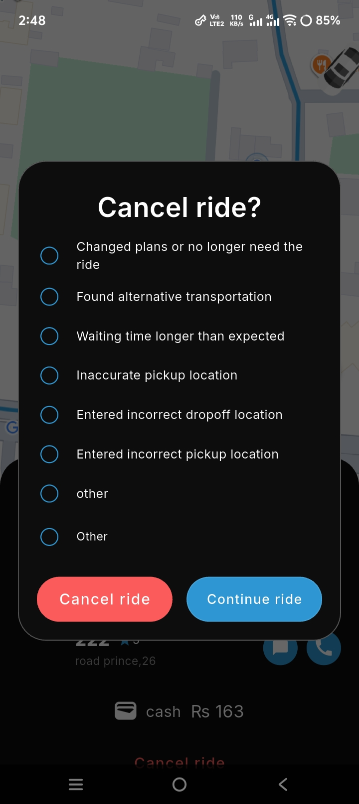 | 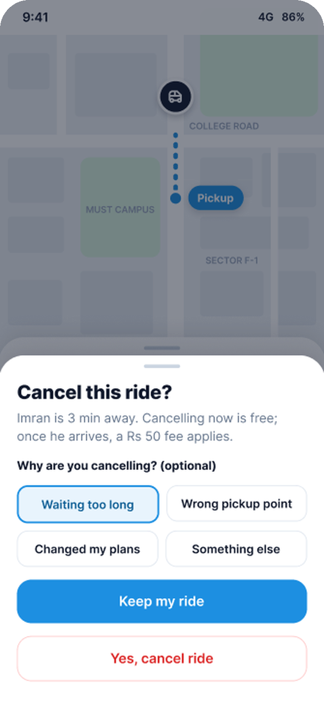 |

## Prototype

The Figma prototype has 8 clickable screens covering the full booking flow, including the error and cancellation paths:

**Home → Plan your ride → Confirm route → Choose a ride → Finding a driver → Driver arriving**, with branches for *No drivers nearby* (book the next-best ride, retry or schedule) and *Cancel ride* (keep the ride or cancel).

## Usability testing and iteration

> **Note:** The usability results below are **hypothetical**, written to illustrate the testing method. They are not measurements from completed sessions.

| Task | Completed | Avg. time | Errors |
| --- | --- | --- | --- |
| 1. Book the cheapest ride from home to MUST | 3/3 | 45 sec | 1 |
| 2. Identify the correct driver and vehicle | 3/3 | 22 sec | 1 |
| 3. No drivers are available; get a ride anyway | 2/3 | 38 sec | 2 |
| 4. Cancel the ride, then change your mind | 2/3 | 32 sec | 2 |

Based on this feedback, three screens were updated (the versions in [`screens/after/after-usability-testing`](screens/after/after-usability-testing)):

- **Choose a ride:** larger fares, with the “Cheapest” tag kept on the preselected ride
- **Driver arriving:** larger number plate; vehicle colour and model on separate lines
- **No drivers nearby:** alternative ride placed above the saved-trip message and the booking button

## HCI principles applied

- **Hick's law:** fewer, sorted choices; unavailable rides grouped away
- **Error prevention:** smart defaults, driver verification, cancellation fee shown before deciding
- **Visibility of system status:** progress bar, ETA, distance and fixed fare shown
- **Recognition over recall:** saved places, labelled icons, bottom navigation
- **Help users recover from errors:** recovery options instead of a dead end
- **Accessibility:** WCAG-compliant contrast, 44 px touch targets, shape plus text instead of colour alone

## Repository contents

```
├── README.md
├── report/        Full HCI report (PDF)
├── personas/      Persona cards
└── screens/
    ├── before-after.png
    ├── before/    Current Chalo Rider app screenshots
    └── after/     Redesigned screens (and updates after usability testing)
```

## Tools

Figma (design and interactive prototype). AI assistance (Claude) was used while creating the screens and documentation.

---

**Haniyya Ahmad** · BS Software Engineering, Mirpur University of Science and Technology (MUST)
